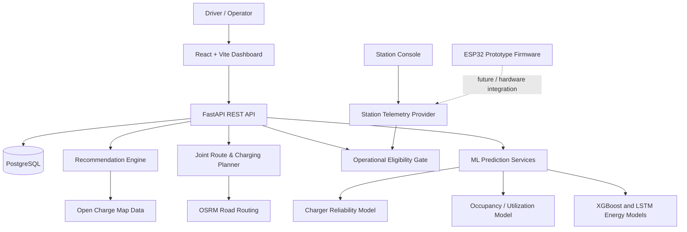

VoltGuide --- AI-Powered EV Charging & Route Planning
VoltGuide is an EV charging intelligence platform that helps drivers
choose charging stations and plan energy-aware journeys. It combines
charger data, machine-learning predictions, road-routing data, battery
constraints, and an operational safety gate in a React dashboard backed
by FastAPI and PostgreSQL.
Prototype and data note: Some vehicle telemetry and
station-console readings are simulated. The energy-prediction models
are trained and evaluated on synthetic data; their reported
performance is not evidence of real-world vehicle-energy accuracy. See
Data, simulation, and limitations.

Highlights
- Charger recommendations: Rank charging stations using factors
  such as historical reliability, availability estimates, distance,
  charging characteristics, and community feedback.
- Energy-aware trip planning: Plan journeys around battery state
  of charge (SoC), battery capacity, reserve energy, connector
  compatibility, and charging stops.
- Multi-stop planning: Evaluate en-route charging stops and
  account for road distance, predicted energy, charging time, and
  estimated waiting time.
- Road routing: Use OSRM to retrieve driving distances, durations,
  and GeoJSON route geometry.
- Operational safety gate: Exclude stations with confirmed faults,
  maintenance/out-of-service status, or other disqualifying
  operational signals. A high recommendation score must not override a
  hard safety exclusion.
- Machine-learning services: Separate models address charger
  reliability, occupancy/utilization, and energy-consumption
  prediction.
- Driver accounts: JWT-based authentication, vehicle profiles,
  trip history, and charger reviews.
- Station console: A state-machine-driven console for available,
  charging, complete, and fault states, with a provider interface
  designed to support simulation or future hardware telemetry.
- ESP32 prototype firmware: Firmware source is included for a
  controller prototype. Physical deployment and electrical sensing
  must be verified separately.
Architecture

Main request flows
Station recommendation 1. Load charger records and available
reliability features. 2. Apply operational eligibility checks before
ranking. 3. Score eligible stations using the recommendation engine. 4.
Return ranked candidates and their available confidence/trust
information.
Trip planning 1. Accept origin, destination, vehicle battery
capacity, current SoC, reserve, and connector. 2. Evaluate direct-route
feasibility and charging alternatives. 3. Retrieve road-route metrics
from OSRM when available. 4. Use AI energy predictions as planning
inputs while retaining the planner's documented baseline for
battery-feasibility accounting. 5. Return route legs, energy accounting,
charging-stop details, and an explanation.
Station state and safety 1. Read station state from the configured
telemetry provider. 2. Apply state transitions through the station
console or ingest telemetry through the hardware-ready API. 3. Feed
active fault/out-of-service information into the operational eligibility
gate. 4. Exclude ineligible stations from planning/recommendation flows
where the gate is applied.
Technology stack
  Area                                Technologies
  Frontend                            React, Vite, JavaScript, Axios
  Backend                             Python, FastAPI, Pydantic
  Database                            PostgreSQL, SQLAlchemy
  ML and data                         pandas, NumPy, scikit-learn,
                                      XGBoost, TensorFlow/Keras
  Road routing                        OSRM
  Charger data                        Open Charge Map API / imported
                                      charger dataset
  Authentication                      JWT-based access tokens
  Hardware prototype                  ESP32 firmware, GPIO state outputs,
                                      fault-button logic
  Testing                             pytest-style Python tests and
                                  frontend test/build tooling
Repository layout
The application is nested under ev-charging-project/.
ev-charging-project/
├── api/                  # FastAPI application and route handlers
├── dashboard/            # React + Vite frontend
├── database/             # SQLAlchemy models, schema, initialization and seed data
├── data/                 # Raw and processed datasets
├── hardware/
│   └── esp32_station/     # ESP32 prototype firmware
├── models/               # Recommendation, routing, safety and ML modules
│   └── artifacts/         # Trained model artifacts and metadata
├── pipeline/             # Open Charge Map ingestion and data preparation
├── testbed/              # Integration, planner, safety and telemetry tests
├── SPEC.md               # Project specification
├── requirements.txt      # Python dependencies
└── README.md
Getting started
Prerequisites
- Python version compatible with
  ev-charging-project/requirements.txt
- Node.js and npm
- Docker with Docker Compose
- Git
External OSRM and Open Charge Map services require network access. Open
Charge Map ingestion may require an API key; a pre-seeded local database
may be used instead when the included Compose/seed setup is available.
1. Clone and enter the application directory
git clone https://github.com/Vielside-RX7/Ev_Charge_Infra.git
cd Ev_Charge_Infra/ev-charging-project
2. Configure environment variables
Create a local .env file in ev-charging-project/. Do not commit
secrets. Use the database name, username, password, and host port
configured by the repository's Docker Compose file.
Example template (replace every placeholder with your local
configuration):
DATABASE_URL=postgresql+psycopg2://<username>:<password>@localhost:<published-port>/<database>
OCM_API_KEY=<optional-open-charge-map-api-key>
If you change the database driver or use a different PostgreSQL setup,
ensure DATABASE_URL matches the installed driver and your database
configuration. The host port in the URL must match the published port in
Docker Compose.
3. Start PostgreSQL
From ev-charging-project/, inspect the Compose configuration and start
the database:
docker compose up -d
If the project seed scripts are mounted as PostgreSQL initialization
scripts, they run only when the database volume is initialized for the
first time. Resetting with docker compose down -v deletes the local
database volume and its data; do so only if you intentionally want a
fresh database.
If the repository's Compose configuration does not seed the database
automatically, follow the initialization instructions in database/ and
the project specification.
4. Set up and run the backend
python -m venv .venv
Activate the environment:
# macOS / Linux
source .venv/bin/activate

# Windows PowerShell
# .venv\Scripts\Activate.ps1
Install dependencies and start FastAPI:
pip install -r requirements.txt
uvicorn api.main:app --reload --port 8000
API root: http://127.0.0.1:8000
Interactive API documentation: http://127.0.0.1:8000/docs
Health endpoint: http://127.0.0.1:8000/health
5. Set up and run the frontend
In a second terminal:
cd dashboard
npm install
npm run dev
Vite prints the local dashboard URL, usually http://localhost:5173.
If the backend is not running at http://localhost:8000, configure
VITE_API_BASE_URL in the frontend's local environment and restart
Vite.
Machine-learning components
The repository contains separate models for different prediction tasks:
  Component               Purpose                    Important qualification
  Reliability model       Predict charger            Evaluate on
                          success/reliability from   representative held-out
                          historical operational,    real-world data before
                          fault, and review          making production
                          features; includes Random  accuracy claims
                          Forest and XGBoost
                          evaluation code            
  Occupancy model         Estimate                   Predictions depend on
                          utilization/availability   training data coverage
                          patterns by time block and and assumptions
                          station features           
  XGBoost energy model    Predict whole-trip energy  Training/evaluation use
                          consumption from vehicle,  synthetic data
                          trip, and environmental    generated from a
                          features                   baseline
                                                     energy-consumption
                                                     simulation
  LSTM energy model       Predict near-term future   Training/evaluation use
                          energy from sequential     synthetic sequences;
                          driving telemetry          not validated physical
                                                 telemetry
The prediction service can expose model availability and diagnostics.
Model outputs should be interpreted alongside the planner's
physical/baseline energy accounting and safety constraints---not as a
replacement for either.
Route planning and safety design
The route-planning modules include a multi-criteria route cost function
and an energy-aware modified A* search. The design considers factors
such as:
- Road distance and estimated travel duration
- Energy required for each leg
- Current battery SoC and reserve energy
- Charger connector compatibility and power rating
- Charging-stop duration and estimated queue waiting
- Station operational eligibility and trust/reliability signals
The documented default energy rate is 0.150 kWh/km (150 Wh/km). It is
an engineering baseline, not a universal consumption rate for all EVs or
conditions.
Safety invariant: station eligibility is separate from ranking
quality. A station rejected by the operational gate should not become
eligible just because it is close, cheap, or highly rated.
API overview
The FastAPI application exposes REST endpoints including:
  Endpoint                                          Purpose
  GET /health                                     Service and database health
                                                    information
  POST /recommend                                 Ranked charger recommendations
  POST /route                                     Driving route to a charger,
                                                    including distance, duration, and
                                                    geometry
  POST /trip/plan                                 Joint route and charging plan;
                                                    supports multi-stop planning
  POST /auth/signup                               Register a user
  POST /auth/login                                Authenticate and obtain a token
  GET /auth/me                                    Retrieve the authenticated user's
                                                    profile
  /chargers/{charger_id}/feedback                 Submit charging-attempt feedback
  GET /chargers/{charger_id}/operational-status   Read operational eligibility and
                                                    trust information
  GET /station/{station_id}/telemetry             Read station telemetry and
                                                    eligibility
  POST /station/{station_id}/simulate             Exercise station state-machine
                                                    transitions
  POST /station/telemetry/ingest                  Ingest a hardware telemetry payload
Use /docs for request schemas, response models, and the full set of
registered endpoints. Authentication requirements may vary by endpoint;
follow the API's declared security behavior.
Station console and ESP32 prototype
The station console provides a state-machine interface for actions such
as starting a charging session, stopping it, completing a session,
injecting a fault, and restoring availability. It polls the backend
telemetry endpoint and displays station state, operational-gate status,
and telemetry metadata.
The telemetry provider is designed to separate the UI/API contract from
the source of telemetry. The repository includes ESP32 firmware with
GPIO state indicators and a fault-button workflow, as well as an
ingestion endpoint for hardware payloads.
Important: the current console labels its hardware engine as a
software simulator and its electrical sensing as simulated/not
connected. The firmware's nominal voltage/current/power values are not
equivalent to sensor measurements. Do not present these values as real
electrical measurements. The firmware source also contains local Wi-Fi
and network configuration that must be replaced before use; keep
credentials out of public commits and rotate any real credentials that
may have been committed.
This prototype is not a certified EVSE controller and must not be
connected to mains or high-voltage charging equipment as a safety
system.
Data, simulation, and limitations
- Synthetic energy data: XGBoost and LSTM energy models are
  documented as trained/evaluated on generated Virtual EV data. Their
  metrics describe fit to that simulated distribution, not validated
  real-world accuracy.
- Charger status freshness: third-party charger listings and
  historical records do not necessarily represent live charger
  telemetry. Display data freshness and confidence where available.
- OSRM availability: route calls depend on the configured OSRM
  service. Fallback geometry or estimates should be disclosed to the
  user and not mistaken for verified road routing.
- Hardware status: the repository includes firmware and a
  hardware-ready API contract, but source code alone does not
  establish that physical hardware is connected or tested.
- Operational safety: this is a prototype for demonstration and
  development, not a safety-certified charging control system.
- Model validation: before production use, evaluate on
  representative real-world datasets, check data leakage, calibrate
  uncertainty, and monitor model drift.
Testing
Run the Python tests from ev-charging-project/ in the configured
virtual environment. For example:
python -m pytest testbed/
Some tests may require a configured database, installed optional ML
dependencies, or network access to external routing services. Run the
relevant tests in the environment described by the project and report
the actual results rather than assuming all tests pass.
Build the frontend to check compilation:
cd dashboard
npm run build
Security and operational checklist
Before sharing or deploying the project:
- Keep .env files, API keys, database passwords, and Wi-Fi
  credentials out of version control.
- Replace any credentials that were ever committed to a public
  repository.
- Confirm JWT signing secrets are configured securely and are not
  hard-coded production defaults.
- Restrict CORS origins and protect state-changing or hardware-ingest
  endpoints appropriately.
- Validate incoming telemetry and enforce authorization for
  operational actions.
- Use HTTPS and appropriate network isolation outside local
  development.
- Do not connect prototype switching hardware to high-voltage or EV
  charging circuits.
Future improvements
- Validate energy and reliability models using real-world,
  time-separated datasets.
- Add automated model evaluation and reproducible training reports.
- Add monitoring for data freshness, external routing failures, and
  prediction drift.
- Harden authorization and audit trails for station control and
  telemetry ingestion.
- Integrate verified physical sensors and a properly isolated,
  safety-reviewed controller.
- Add deployment automation, API integration tests, and a reproducible
  environment setup.
License
Add the license and attribution terms that apply to this repository and
its third-party datasets/dependencies before redistributing the project.
