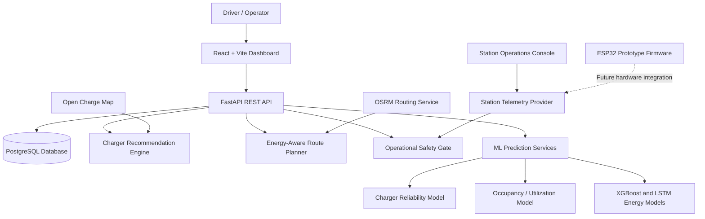

# VoltGuide — AI-Powered EV Charging & Route Planning

VoltGuide is an AI-powered electric vehicle (EV) charging and route-planning platform designed to help drivers discover charging stations, estimate energy requirements, and plan journeys around battery constraints. It combines charger recommendations, machine-learning prediction services, road-routing data, and operational safety checks in a full-stack application.

> **Project status:** Prototype / active development. Some station telemetry and console readings are simulated. The energy-prediction models are trained and evaluated using synthetic data; their results should not be interpreted as validated real-world EV energy accuracy.

## ✨ Key Features

- **AI-Assisted Charger Recommendations** — Rank eligible charging stations using available reliability, distance, charging, and community-feedback information.
- **Energy-Aware Route Planning** — Account for battery capacity, current state of charge (SoC), reserve energy, and vehicle requirements when planning journeys.
- **Multi-Stop Charging Optimization** — Evaluate intermediate charging stops using route distance, predicted energy demand, charging duration, and estimated waiting time.
- **Road Routing with OSRM** — Retrieve driving routes, distances, durations, and route geometry.
- **Operational Safety Gate** — Exclude stations with disqualifying faults or out-of-service states before recommendation ranking.
- **Machine-Learning Components** — Separate modules for charger reliability, occupancy/utilization, and energy-consumption prediction.
- **User Accounts and Profiles** — JWT-based authentication, vehicle profiles, trip history, and charger feedback.
- **Station Operations Console** — Simulate charging-state transitions, fault events, and station availability through a dashboard.
- **ESP32 Prototype Firmware** — Includes firmware source and a telemetry integration interface for future hardware testing.

## 🏗️ System Architecture



### How It Works

**1. Charger recommendations**

1. Retrieve available charger records and relevant features.
2. Evaluate station operational eligibility.
3. Apply recommendation scoring to eligible candidates.
4. Return ranked charging options with available reliability or trust information.

**2. Energy-aware trip planning**

1. Accept journey details and vehicle battery parameters.
2. Evaluate route feasibility against current SoC and reserve requirements.
3. Retrieve road-routing information from OSRM when available.
4. Evaluate possible charging stops and energy requirements.
5. Return route legs, estimated energy usage, and charging-stop information.

**3. Station monitoring and operational safety**

1. Read station state through the configured telemetry provider.
2. Simulate station-state transitions or accept a telemetry payload.
3. Propagate relevant faults and out-of-service information to the operational safety gate.
4. Exclude ineligible stations wherever that gate is applied.

## 🛠️ Technology Stack

| Layer | Technologies |
|---|---|
| Frontend | React, Vite, JavaScript, Axios |
| Backend | Python, FastAPI, Pydantic |
| Database | PostgreSQL, SQLAlchemy |
| Machine Learning | scikit-learn, XGBoost, TensorFlow/Keras |
| Data Processing | pandas, NumPy |
| Routing | OSRM |
| Charger Data | Open Charge Map API and imported charger datasets |
| Authentication | JWT-based authentication |
| Hardware Prototype | ESP32 firmware, GPIO state indicators, fault-button logic |
| Testing | Python test suite and frontend build tooling |

## 📁 Project Structure

The main application is located in the `ev-charging-project/` directory.

```text
Ev_Charge_Infra/
└── ev-charging-project/
    ├── api/                  # FastAPI application and route handlers
    ├── dashboard/            # React + Vite frontend
    ├── database/              # Database models, schema, initialization, and seeds
    ├── data/                  # Raw and processed datasets
    ├── hardware/
    │   └── esp32_station/     # ESP32 prototype firmware
    ├── models/                # Routing, recommendation, safety, and ML modules
    │   └── artifacts/         # Model artifacts and metadata
    ├── pipeline/              # Charger-data ingestion and preparation
    ├── testbed/               # Tests for routing, safety, and telemetry
    ├── SPEC.md                # Project specification
    ├── requirements.txt       # Python dependencies
    └── README.md
```

## 🚀 Getting Started

### Prerequisites

Install the following tools before starting:

- Git
- Python compatible with the project's dependencies
- Node.js and npm
- Docker and Docker Compose

Network access may be required for external OSRM routing and Open Charge Map data retrieval.

### 1. Clone the Repository

```bash
git clone https://github.com/Vielside-RX7/Ev_Charge_Infra.git
cd Ev_Charge_Infra/ev-charging-project
```

### 2. Configure Environment Variables

Review the backend and database configuration to determine which environment variables are required.

If your local setup uses a `.env` file, create it inside `ev-charging-project/`. The following is an illustrative template; replace the placeholders with values matching your configuration.

```dotenv
DATABASE_URL=postgresql+psycopg2://<username>:<password>@localhost:<published-port>/<database>
OCM_API_KEY=<your-open-charge-map-api-key>
```

**Important:**
- Use the PostgreSQL host port published by your Docker Compose configuration.
- Confirm the database name, username, password, and driver match your setup.
- Configure an Open Charge Map API key if required by your ingestion workflow.
- Never commit database credentials, API keys, JWT secrets, or other sensitive configuration to GitHub.

### 3. Start the Database

From the `ev-charging-project/` directory:

```bash
docker compose up -d
```

Check that the database container is running and that the backend's database connection settings match the published port.

Database initialization and seed-data availability depend on the repository's Compose and database initialization configuration.

> **Warning:** Running `docker compose down -v` deletes associated persistent volumes, including local database data. Only use it when you intentionally want to reset the database.

### 4. Install and Run the Backend

Create a virtual environment:

```bash
python -m venv .venv
```

Activate it.

**macOS / Linux**

```bash
source .venv/bin/activate
```

**Windows PowerShell**

```powershell
.venv\Scripts\Activate.ps1
```

Install dependencies:

```bash
pip install -r requirements.txt
```

Start the FastAPI application:

```bash
uvicorn api.main:app --reload --port 8000
```

Once running, the local API is available at:

| Resource | URL |
|---|---|
| API base URL | http://127.0.0.1:8000 |
| Interactive API documentation | http://127.0.0.1:8000/docs |
| Health endpoint | http://127.0.0.1:8000/health |

### 5. Install and Run the Frontend

Open another terminal and navigate to the dashboard directory:

```bash
cd dashboard
npm install
npm run dev
```

Vite will display the local dashboard URL in the terminal, usually:

```text
http://localhost:5173
```

If the API is running at a different address, configure the frontend API base URL using the environment-variable convention supported by the dashboard, then restart the development server.

## 🧠 Machine-Learning Components

VoltGuide separates prediction tasks into specialized modules.

| Component | Purpose | Current Limitation |
|---|---|---|
| Charger Reliability Model | Estimate charger reliability using available operational, fault, and review-related features. Includes Random Forest and XGBoost evaluation code. | Requires representative real-world validation before production accuracy claims. |
| Occupancy / Utilization Model | Estimate station utilization or availability patterns. | Prediction quality depends on data coverage and the training distribution. |
| XGBoost Energy Model | Estimate trip energy consumption from vehicle, journey, and environmental features. | Training and evaluation use synthetic data. |
| LSTM Energy Model | Model near-term energy patterns from sequential driving data. | Training and evaluation use synthetic sequences and are not validated physical telemetry. |

The machine-learning models are designed to support planning and recommendations. Their outputs should be interpreted alongside battery-feasibility calculations, data quality, and operational constraints.

**Synthetic-data disclaimer:** Performance measured on generated data does not establish real-world accuracy. Validation on representative, independently collected EV driving and charging data is required before relying on these models for real journeys.

## 🗺️ Route Planning and Safety

The routing modules include an energy-aware modified A* search, multi-criteria route scoring, and multi-stop charging planning.

Depending on the workflow and available data, planning can account for:

- Road distance and estimated driving duration
- Energy demand for individual route legs
- Current battery state of charge and reserve energy
- Connector compatibility and charger power
- Charging duration and estimated waiting time
- Station operational eligibility and reliability signals

The documented default energy-consumption baseline is **0.150 kWh/km (150 Wh/km)**. This is an engineering baseline, not a universal consumption rate; actual energy usage varies by vehicle, speed, terrain, weather, traffic, and driving style.

### Operational Safety Principle

**Eligibility is separate from recommendation ranking.** A station that fails a required operational safety check must not become eligible merely because it is nearby or has a high recommendation score or user rating.

This project is a software prototype. The safety gate is not a substitute for certified EV charging protection systems or a professionally validated electrical safety design.

## 🔌 API Overview

The FastAPI application includes REST endpoints for health checks, route planning, recommendations, authentication, charger feedback, and station telemetry.

| Method | Endpoint | Purpose |
|---|---|---|
| `GET` | `/health` | Check service and database health |
| `POST` | `/recommend` | Retrieve charger recommendations |
| `POST` | `/route` | Retrieve driving-route information |
| `POST` | `/trip/plan` | Generate an energy-aware route and charging plan |
| `POST` | `/auth/signup` | Register a user |
| `POST` | `/auth/login` | Authenticate and obtain an access token |
| `GET` | `/auth/me` | Retrieve the authenticated user's profile |
| `POST` | `/chargers/{charger_id}/feedback` | Submit charger feedback |
| `GET` | `/chargers/{charger_id}/operational-status` | Retrieve operational eligibility and trust information |
| `GET` | `/station/{station_id}/telemetry` | Retrieve station telemetry and eligibility information |
| `POST` | `/station/{station_id}/simulate` | Simulate station-state transitions |
| `POST` | `/station/telemetry/ingest` | Accept a station telemetry payload |

For request schemas, response structures, and additional registered endpoints, start the backend and visit:

**http://127.0.0.1:8000/docs**

Authentication and authorization requirements vary by endpoint and should be checked against the API implementation.

## ⚡ Station Console and ESP32 Prototype

The station console provides a software interface for testing station states and operational workflows, including starting or stopping a session, completing a session, injecting a fault, and restoring availability.

The repository also includes ESP32 prototype firmware with GPIO indicators and fault-button logic, together with a telemetry-ingestion interface intended to support future hardware integration.

### Hardware and Simulation Disclaimer

- The dashboard identifies its current hardware engine as a **software simulator**.
- Electrical sensing is indicated as **simulated / not connected**.
- Firmware voltage, current, and power values must not be represented as actual sensor measurements unless verified physical sensors are installed and tested.
- Including firmware and a telemetry API does not establish that physical hardware has been connected, commissioned, or validated.
- The prototype is not a certified EVSE controller and must not be relied on as a safety system for mains or high-voltage charging equipment.

Before deploying firmware, replace local Wi-Fi and network configuration with appropriate settings. Never publish real credentials, and rotate any genuine credentials that may already have been committed.

## ⚠️ Data, Simulation, and Limitations

- **Synthetic energy-model data:** The XGBoost and LSTM energy components use generated training/evaluation data. Their metrics do not demonstrate validated performance on real EVs.
- **Charger data freshness:** Imported datasets and third-party charger listings may not represent live station availability or current operating status.
- **Routing availability:** Route requests depend on the configured OSRM service. Any fallback estimates or geometry should not be mistaken for verified road-routing results.
- **Hardware integration:** The firmware and telemetry contract are prototype components; source code alone does not prove physical deployment or testing.
- **Operational safety:** This is a development and demonstration platform, not a certified charging control system.
- **Model validation:** Production use requires representative validation datasets, appropriate separation of training and test data, uncertainty evaluation, and ongoing performance monitoring.

## 🧪 Testing

Run the Python tests from the `ev-charging-project/` directory with the virtual environment activated:

```bash
python -m pytest testbed/
```

Some tests may require a configured database, optional machine-learning dependencies, or access to external services. Confirm prerequisites before interpreting test results.

Build the frontend to check compilation:

```bash
cd dashboard
npm run build
```

Document the actual test results for your environment rather than assuming all tests pass.

## 🔐 Security Checklist

Before sharing, demonstrating, or deploying the application:

- Keep `.env` files, API keys, database passwords, JWT secrets, and Wi-Fi credentials out of version control.
- Replace and rotate any genuine credentials previously committed to a public repository.
- Verify JWT signing configuration and avoid insecure production defaults.
- Restrict CORS origins appropriately for the deployment environment.
- Validate incoming telemetry payloads and enforce authorization on state-changing endpoints.
- Use HTTPS and appropriate network isolation outside local development.
- Review dependency versions and known vulnerabilities.
- Do not connect prototype switching hardware to high-voltage or EV charging circuits without professionally engineered protections and appropriate safety validation.

## 🔮 Future Improvements

- Validate energy-consumption and reliability models on representative real-world datasets.
- Add reproducible training pipelines and automated model-evaluation reports.
- Improve monitoring of charger-data freshness, routing failures, and model drift.
- Strengthen API authorization, station-control safeguards, and telemetry audit trails.
- Integrate verified sensors and a properly isolated, safety-reviewed hardware controller.
- Expand automated integration testing and simplify reproducible development setup.
- Improve prediction confidence reporting and communicate estimation uncertainty to drivers.

---

**VoltGuide — Smarter EV Charging, Energy-Aware Journeys, and Safer Station Recommendations.**
